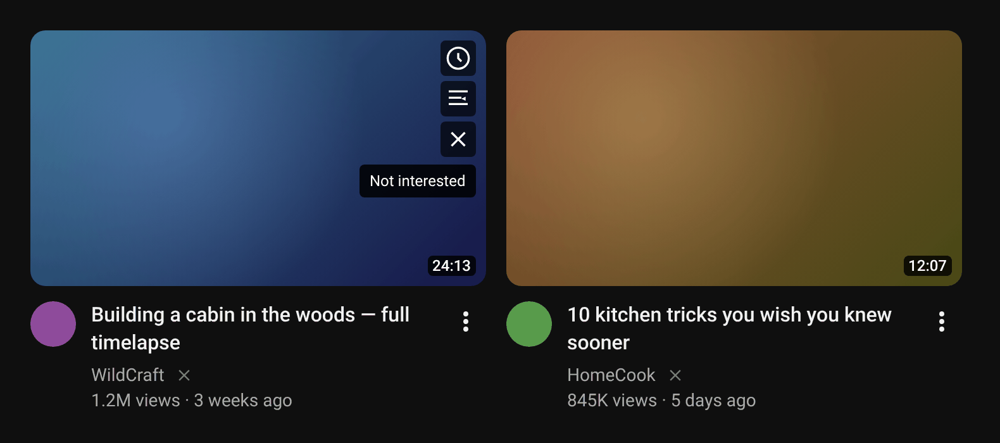
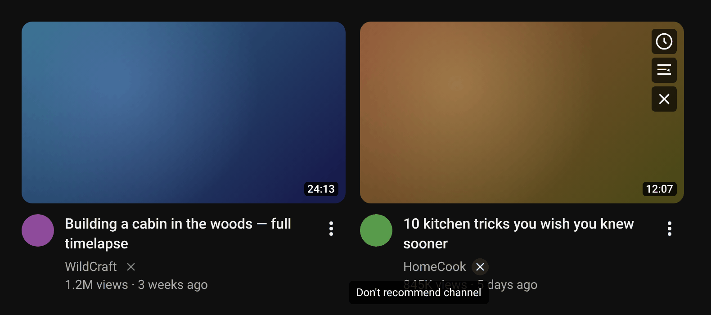
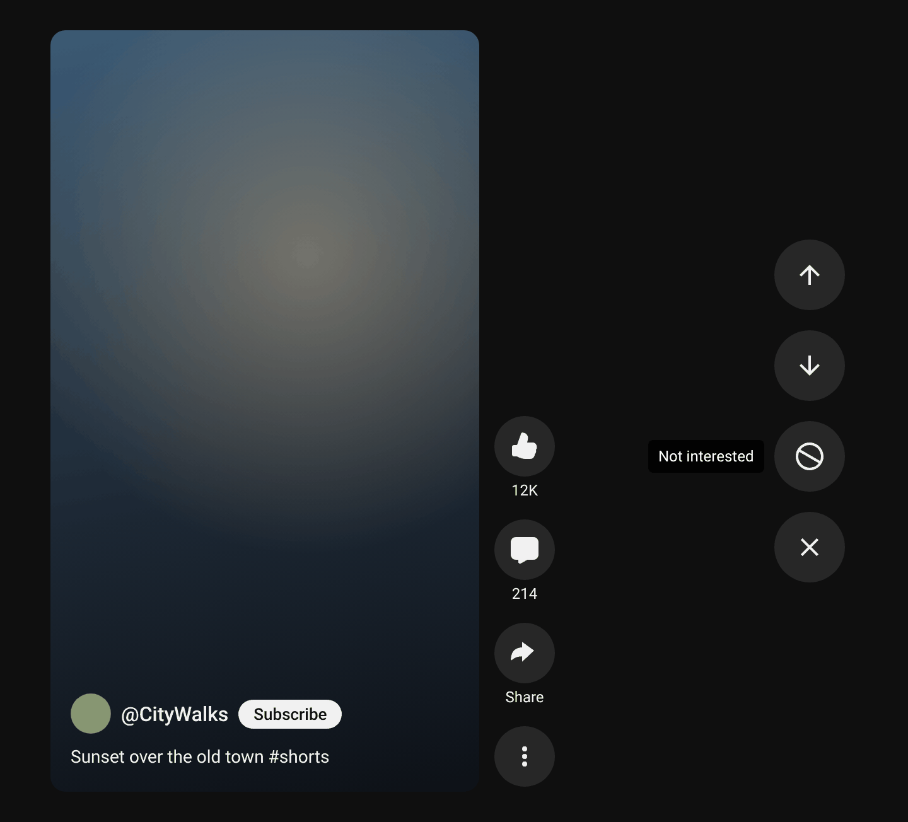

# YouTube Rec Cleaner

A userscript that cleans up YouTube recommendations:

- **Hides Mixes and Radio** on the home page, in search and in the watch-page sidebar. Pure CSS, no flashing.
- **Home feed:** an X on the thumbnail ("Not interested") and an X next to the channel name ("Don't recommend channel").
- **Shorts:** two buttons below the navigation arrows: ⊘ "Not interested" and ✕ "Don't recommend channel". After the action the script scrolls to the next Short if YouTube didn't do it itself.

Every action goes through YouTube's own menu, so YouTube gets exactly the same signal as from a manual click.

## Screenshots

**Home feed:** "Not interested" on the thumbnail (appears on hover, next to Watch later / Add to queue)



**Home feed:** "Don't recommend channel" next to the channel name



**Shorts:** ⊘ "Not interested" and ✕ "Don't recommend channel" below the navigation arrows



<sub>The buttons are rendered by the script itself; the surrounding page is a simplified mock-up of YouTube.</sub>

## Install

1. Install a userscript manager: [Tampermonkey](https://www.tampermonkey.net/) or [Violentmonkey](https://violentmonkey.github.io/).
2. Open this link and the manager will offer to install the script:
   **https://raw.githubusercontent.com/Common-Fool/Youtube-Rec-Cleaner/main/youtube-rec-cleaner.user.js**

Updates are automatic: the manager compares `@version` against the file on the `main` branch.

## Settings

Edits made inside the script file are lost on auto-update, so custom settings live in youtube.com's `localStorage` (F12 console):

```js
// example: don't auto-scroll Shorts, and show the X buttons across the whole feed, not just the home page
localStorage['ytrc:cfg'] = JSON.stringify({
    shorts: { autoNext: false },
    feed: { onlyHomePage: false },
});
// reset
localStorage.removeItem('ytrc:cfg');
```

All available keys are listed with comments in the `DEFAULTS` block at the top of the script. The given keys are merged over the defaults; reload the page after changing them.

## Troubleshooting

YouTube changes its markup often. If a Shorts button stops working, open a Short, run this in the console

```js
__ytrc.diag(true)
```

and attach the output to an [issue](https://github.com/Common-Fool/Youtube-Rec-Cleaner/issues). It shows which ⋮ buttons the script found and which items their menus contain.

Verbose logging: `localStorage['ytrc:cfg'] = JSON.stringify({ debug: true })`.

## Support the project

If the script saves you some nerves, you can support its development:

| Method | Link |
|---|---|
| Monobank (jar, any bank card) | https://send.monobank.ua/jar/6m4nBQCW9B |
| Ko-fi | https://ko-fi.com/commonfool |
| Crypto (NOWPayments) | https://nowpayments.io/donation/commonfool |


